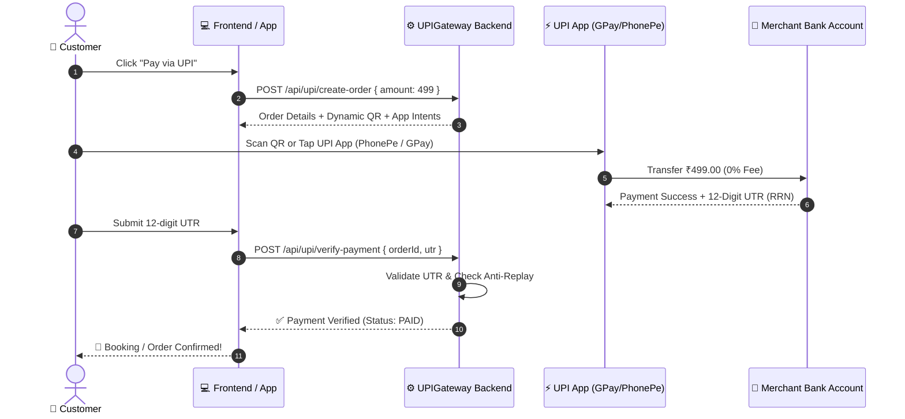

# ⚡ UPIGateway

> **Zero-Fee Open-Source UPI Payment Gateway for Node.js, Express & React**  
> Direct peer-to-merchant bank settlements with **0% MDR fees**, dynamic QR code generation, mobile UPI app intents (Google Pay, PhonePe, Paytm, BHIM), and automated 12-digit UTR verification.

[](https://opensource.org/licenses/MIT)
[](https://nodejs.org/)
[](https://www.npci.org.in/)
[](#)

---

## 🎯 Why UPIGateway?

Commercial payment gateways (like Razorpay, Cashfree, PayU, and Stripe) typically charge **2% + 18% GST (approx. 2.36%)** per transaction, enforce strict account freezes, and hold your settlements for **2 to 3 days (T+2)**.

Under Reserve Bank of India (RBI) and NPCI mandates, standard bank-to-bank UPI transfers carry **0% MDR (Merchant Discount Rate)**. 

**UPIGateway** provides a complete, developer-first alternative:
* 💰 **0% Transaction Fees:** 100% of the customer's money lands directly in your bank account.
* ⚡ **Instant Settlement:** Zero delay — funds are credited immediately to your VPA.
* 📱 **Native Mobile Intents:** One-click checkout buttons for PhonePe, Google Pay, Paytm, and BHIM.
* 📷 **Dynamic QR Codes:** Real-time generated SVG and Base64 PNG QR codes with pre-filled amounts and order IDs.
* 🛡️ **12-Digit UTR Validator & Anti-Replay:** Protects against duplicate submissions, fake receipts, and replay attacks.
* 🔐 **HMAC-SHA256 Webhooks:** Cryptographically signed callback alerts for instant background reconciliation.
* 🧪 **Built-in Sandbox Simulator:** Test full payment flows locally without spending real money.
* 🎨 **Drop-in OLED Dark Theme React Modal:** Ready-to-use checkout UI component for React, Next.js, and Capacitor apps.

---

## 🔄 Architecture & Payment Flow



---

## 🚀 Quick Start

### 1. Installation

Clone the repository or install via npm:

```bash
git clone https://github.com/Priyanshu-kumar-maurya/upigateway-.git
cd upigateway-
npm install
```

### 2. Standalone Microservice Setup

Create a `.env` file in the project root:

```env
PORT=5000
UPI_VPA=yourbusiness@icici
MERCHANT_NAME=My Awesome Store
UPI_SANDBOX=false
UPI_SECRET_KEY=your_super_secret_webhook_key_2026
```

Start the API server:

```bash
npm start
```

---

## 💻 Programmatic Usage (Node.js SDK)

You can use UPIGateway directly inside your existing Express backend:

```javascript
const express = require('express');
const UPIGateway = require('upigateway');

const app = express();
app.use(express.json());

// Initialize Gateway
const gateway = new UPIGateway({
  vpa: 'merchant@icici',
  merchantName: 'My Brand',
  sandbox: false, // Set true for simulated testing
  secretKey: 'my_webhook_secret'
});

// 1. Create Order Endpoint
app.post('/api/checkout', async (req, res) => {
  const { amount, customerName } = req.body;

  const order = await gateway.createOrder({
    amount,
    customerName,
    note: 'Premium Subscription',
    expiryMinutes: 10
  });

  res.json({ success: true, order });
});

// 2. Verify Payment Endpoint
app.post('/api/verify', async (req, res) => {
  const { orderId, utr } = req.body;

  const result = await gateway.verifyPayment({ orderId, utr });
  if (result.success) {
    // Fulfill order, credit wallet, or update database
    res.json({ success: true, message: 'Payment confirmed!' });
  } else {
    res.status(400).json(result);
  }
});
```

---

## 🎨 Drop-in React Component (`UPICheckout`)

Import the pre-styled, OLED dark theme checkout modal directly in React:

```jsx
import React, { useState } from 'react';
import UPICheckout from 'upigateway/src/client/UPICheckout';
import 'upigateway/src/client/UPICheckout.css';

export default function CheckoutPage() {
  const [isOpen, setIsOpen] = useState(false);
  const [order, setOrder] = useState(null);

  const handlePay = async () => {
    const res = await fetch('/api/upi/create-order', {
      method: 'POST',
      headers: { 'Content-Type': 'application/json' },
      body: JSON.stringify({ amount: 499 })
    });
    const data = await res.json();
    setOrder(data.order);
    setIsOpen(true);
  };

  return (
    <div>
      <button onClick={handlePay}>Pay ₹499 via UPI</button>

      <UPICheckout
        isOpen={isOpen}
        onClose={() => setIsOpen(false)}
        order={order}
        onSuccess={(data) => {
          alert(`Payment Successful! UTR: ${data.utr}`);
          setIsOpen(false);
        }}
        onFailure={(err) => alert(err.error)}
      />
    </div>
  );
}
```

---

## 📡 REST API Reference

| Method | Endpoint | Description |
| :--- | :--- | :--- |
| `POST` | `/api/upi/create-order` | Creates a new order, dynamic QR code, and mobile app intent URLs. |
| `POST` | `/api/upi/verify-payment` | Validates submitted 12-digit UTR against anti-replay and marks order as PAID. |
| `GET` | `/api/upi/order-status/:orderId` | Retrieves current status of an order (`PENDING`, `PAID`, `EXPIRED`). |
| `GET` | `/api/upi/config` | Returns public configuration (VPA, Merchant Name, Sandbox flag). |
| `POST` | `/api/upi/webhook` | Ingests bank / observer webhooks with HMAC-SHA256 signature verification. |

---

## 🧪 Testing

Run the automated test suite covering QR generation, UTR regex parsing, anti-replay guards, and cryptographic HMAC signing:

```bash
npm test
```

### Run Live Interactive Demo

```bash
npm run demo
```
Then open [http://localhost:3000](http://localhost:3000) in your browser to experience the live checkout modal!

---

## 🛡️ Security Features

1. **Anti-Replay Protection:** Once a 12-digit UTR is consumed, it is permanently locked to prevent users from reusing transaction receipts.
2. **Repetitive Sequence Guard:** Detects and blocks fake dummy numbers (e.g., `000000000000`, `111111111111`).
3. **Session Expiry:** Orders automatically expire after a configurable window (default: 10 minutes).
4. **HMAC-SHA256 Signatures:** Webhook callbacks are signed with a shared secret to prevent spoofing.

---

## 📄 License

Distributed under the **MIT License**. Free for commercial and private use.

Crafted with ❤️ by **[Priyanshu Maurya](https://github.com/Priyanshu-kumar-maurya)**.
